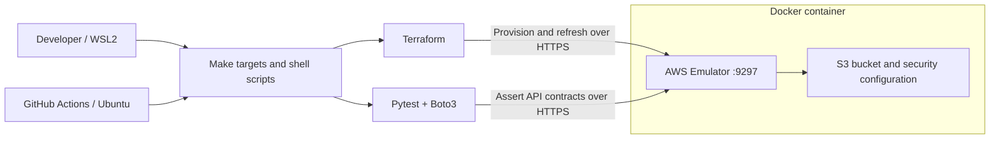

# Cloud Fidelity Lab

[](https://github.com/pedroschmid/cloud-fidelity-lab/actions/workflows/ci.yml)

**Provision infrastructure. Verify its contracts. Prove the next plan changes nothing.**

A hands-on DevOps lab that provisions an S3 security baseline with Terraform and validates it through Boto3 contract tests against AWS Emulator.

The CI pipeline builds a fresh emulated environment, provisions the infrastructure, runs the tests, and checks Terraform idempotence.

## At a glance

| Area | Implementation |
| --- | --- |
| Infrastructure as code | Terraform with a committed AWS provider lock file |
| Storage baseline | S3 bucket, Block Public Access, SSE-S3 default encryption, versioning |
| Contract testing | Seven Boto3/Pytest tests, including retrieval of historical object versions |
| Local environment | AWS Emulator in Docker, accessed over HTTPS with its generated CA |
| Continuous integration | GitHub Actions: provision, test, verify idempotence, remove container |
| AWS credentials | Generated emulator credentials; no AWS account credentials required |

## Architecture



The host exposes the emulator at `https://127.0.0.1:9297`. Terraform and Boto3 use the emulator's generated credentials and CA certificate.

See [architecture and design decisions](docs/architecture.md).

## What the tests verify

| Contract | Assertion |
| --- | --- |
| Bucket existence | `HeadBucket` succeeds |
| Bucket discovery | The bucket appears in `ListBuckets` |
| Naming convention | The configured bucket name has the expected prefix and suffix |
| Public access configuration | All four Block Public Access flags are enabled |
| Default encryption configuration | SSE-S3 uses `AES256`, without a KMS key |
| Versioning configuration | Bucket versioning is `Enabled` |
| Version preservation | Two writes produce distinct version IDs; both versions remain readable; an unversioned read returns the latest |

The version-preservation test generates a unique object key and registers cleanup callbacks to delete the specific versions it creates.

These checks validate the emulator's API behavior. They do not establish production AWS equivalence or independently verify physical encryption at rest.

## Quick start

### Prerequisites

- Linux or WSL2 with Bash, Make, curl, and Docker.
- An x86_64 environment: the current Dockerfile downloads the x86_64 emulator RPM.
- Terraform `>= 1.9.0`; CI uses `1.14.6`.
- Python `>= 3.11` with virtual environment support; CI uses Python `3.14`.
- Internet access to download the image, emulator package, provider, and Python dependencies.
- Capacity for the emulator container's configured 2 GiB memory limit.

Run these commands from a Bash terminal:

```bash
git clone https://github.com/pedroschmid/cloud-fidelity-lab.git
cd cloud-fidelity-lab

python3 -m venv .venv
.venv/bin/python -m pip install -e ".[test]"

make up

./scripts/terraform.sh init -input=false -lockfile=readonly
make tf-validate
make tf-plan
make tf-apply
```

Review the plan and enter `yes` when Terraform requests confirmation.

On a fresh environment, Terraform should create four resources: the bucket, public access block, encryption configuration, and versioning configuration.

### Verify the result

```bash
make lint-python
terraform fmt -check -recursive infra/
make test-contracts
./scripts/terraform.sh plan -detailed-exitcode
```

Expected results:

```text
7 passed
No changes. Your infrastructure matches the configuration.
```

For the final plan, exit code `0` means no changes, `1` means an error, and `2` means Terraform proposes changes.

## Continuous integration

The [CI workflow](.github/workflows/ci.yml) runs on pushes to `main`, pull requests, and manual dispatch.

1. Install Python dependencis and Terraform.
2. Check Python lint, Python formatting, and Terraform formatting.
3. Build and start AWS Emulator.
4. Initialize Terraform using the committed provider lock file.
5. Validate, save a plan, and apply that saved plan.
6. Run all seven infrastructure contract tests.
7. Require a second plan to report no change.
8. Remove the emulator container, including after failures.

The pipeline provisions infrastructure inside its own temporary emulator environment.

A successful run was observed for commit
[`9388493`](https://github.com/pedroschmid/cloud-fidelity-lab/commit/9388493db1a75da45b6f25fbb0d9c7618c318b2d):
four resources created, seven tests passed, and a final plan with no changes.

[View pipeline runs](https://github.com/pedroschmid/cloud-fidelity-lab/actions/workflows/ci.yml)

## Useful commands

| Command | Purpose |
| --- | --- |
| `make build` | Build the emulator image |
| `make up` | Create the emulator container and wait for health |
| `make status` | Show the emulator container |
| `make logs` | Follow emulator logs |
| `make lint-python` | Check Python lint and formatting |
| `make test-contracts` | Run infrastructure contract tests |
| `make tf-plan` | Review proposed infrastructure changes |
| `make tf-apply` | Apply infrastructure changes interactively |
| `make tf-destroy` | Destroy Terraform-managed emulator resources |
| `make down` | Remove the emulator container |

### Cleanup and reruns

To destroy the managed infrastructure, keep the emulator running and execute:

```bash
make tf-plan
make tf-destroy
make down
```

`make down` removes the container. It does not remove the local Terraform state or the emulator files under `~/.aws/emulator/`.

If you remove the container while keeping Terraform state, the next container may not contain the resources recorded in that state. Review the next plan before applying.

The bootstrap script creates a container when none exists. If an existing container is stopped or unhealthy, inspect it with `make status` and `docker logs cloud-fidelity-emulator` before deciding whether to recreate it.

## Project layout

```text
.github/workflows/ci.yml       CI provisioning and contract validation
docker/Dockerfile.emulator    Emulator image
infra/                        Terraform resources, provider, and lock file
scripts/                      Bootstrap, Terraform wrapper, and test runner
tests/conftest.py              Emulator client and bucket fixtures
tests/test_infrastructure.py   Seven infrastructure contract tests
docs/                         Architecture, test strategy, and limitations
```

## Scope and tradeoffs

This is a focused infrastructure testing demo, with a working local and CI path.

Current boundaries include local Terraform state, an emulator package downloaded from an unpinned `LTS/latest` URL, Python dependencies expressed as version ranges, and no validation against a real AWS account.

IAM enforcement, anonymous-access rejection, disaster recovery, and production operational controls are outside the tested scope.

See [testing strategy](docs/testing-strategy.md) and [limitations](docs/limitations.md).

## Possible next increments

- Pin the emulator package and record its exact version in CI.
- Lock Python dependencies and pin GitHub Actions to reviewed commit SHAs.
- Add behavioral checks for default encryption metadata and delete markers.
- Add Terraform static analysis as an enforced CI stage.
- Introduce a separate, explicitly configured real-AWS validation environment.

Each increment should include its own evidence and semantic commit.
